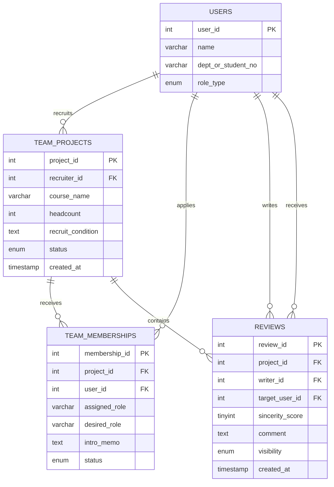

# 모아팀 (UnivPro)

대학 팀 과제에서 팀원을 모집하고, 지원을 검토하며, 프로젝트 완료 후 서로의 협업 경험을 리뷰하는 MVP입니다.

## 1. 프로젝트 개요 및 문제 정의

팀 과제는 적절한 협업자를 찾고 역할을 나누는 데서 시작하지만, 기존 모집 과정에서는 지원 이력과 이전 협업 경험을 한곳에서 확인하기 어렵습니다. 모아팀은 모집글, 지원·승인 과정, 완료 프로젝트의 상호 리뷰를 한 흐름으로 연결해 팀 구성과 협업 경험 공유를 돕습니다.

MVP에서는 회원가입·로그인·웹메일 인증을 구현하지 않습니다. 화면 상단에서 데모 사용자를 선택해 구인자와 지원자 역할을 바꾸며 기능을 확인합니다. 데모 사용자는 `schema.sql` 실행 시 생성됩니다.

## 2. 핵심 기능 및 시나리오

### 화면

1. **UI-01 모집글 목록 및 작성**: 과목명, 모집인원, 모집조건을 입력해 모집글을 생성합니다.
2. **UI-02 모집글 상세 및 상대 리뷰**: 구인자의 공개 리뷰를 조회하고 희망 역할·자기소개 메모와 함께 지원합니다.
3. **UI-03 지원자 관리**: 지원자의 공개 리뷰를 조회하고 지원을 승인·거절하거나 모집을 조기 마감·취소합니다.
4. **UI-04 프로젝트 진행 및 완료**: 모집/진행/완료 상태를 확인하고 구인자가 진행 중 프로젝트를 완료합니다.
5. **UI-05 상호 리뷰**: 완료 프로젝트 참여자에게 1~5점 리뷰를 제출합니다. 처음에는 `PRIVATE_PENDING`이며 같은 프로젝트에서 상대방의 반대 방향 리뷰가 제출되면 양쪽 리뷰가 `PUBLIC`으로 바뀝니다. 내 리뷰 목록에는 공개된 리뷰만 표시됩니다.

### 상태 규칙

- 프로젝트: `RECRUITING` -> 정원 충족 승인 또는 `closeRecruitment` -> `IN_PROGRESS` -> 구인자 `completeProject` -> `COMPLETED`.
- 프로젝트: 구인자 `cancelProject`는 `RECRUITING`에서 `CANCELLED`로 변경합니다. 조기 마감은 정원 미달이어도 가능합니다.
- 지원: `APPLIED`에서 구인자가 승인하면 `APPROVED`, 거절하면 `REJECTED`입니다. 모집 정원 초과 승인은 허용하지 않습니다.
- 리뷰: `COMPLETED` 프로젝트만 리뷰 제출이 가능합니다. 한쪽 리뷰만 제출된 동안은 계속 비공개입니다.
- 양방향 과거 리뷰 조회는 `PUBLIC`인 리뷰만 반환합니다.

중복 지원·중복 리뷰 및 자기 리뷰 방지, 외부 게시판 연동, 성향 프로필, 리뷰 타임아웃 공개, 비방 필터링, 알림은 MVP 범위에서 제외했습니다.

## 3. 시스템 아키텍처 및 ERD

```text
React (Vite)
    | HTTP/JSON
    v
Node.js + Express
Controller -> Service/Domain Policy -> Repository -> MySQL
```

`Service/Domain Policy`에서 상태 전이와 입력 검증을 수행하고, Repository는 SQL 및 트랜잭션을 담당합니다. 정원 승인과 상호 리뷰 공개 처리는 트랜잭션 안에서 수행합니다.



`team_projects.recruiter_id`는 모집글 작성자와 구인자 권한을 연결하기 위해 추가한 FK입니다. `headcount`는 모집할 팀원 수이며, 승인된 지원자 수와 비교합니다(구인자는 정원 수에 포함하지 않음).

## 4. 폴더 구조 및 실행 방법

```text
.
├── client/                 # React + Vite 화면
│   └── src/
├── server/
│   ├── sql/schema.sql       # DB 및 데모 사용자 생성
│   ├── src/
│   │   ├── config/          # MySQL 연결
│   │   ├── controllers/     # HTTP 라우트 및 응답
│   │   ├── domain/           # 상태 정책과 도메인 상수
│   │   ├── repositories/    # MySQL 쿼리/트랜잭션
│   │   └── services/        # 입력 검증 및 기능 흐름
│   └── test/                # Node 테스트 러너 기반 정책/서비스 테스트
├── .github/agents/          # 프로젝트 전용 코딩 에이전트 지침
└── package.json             # npm workspaces 및 통합 명령
```

### 준비 및 실행

필요 환경: Node.js 20 이상, npm, MySQL 8 이상.

1. MySQL에서 `server/sql/schema.sql`을 실행합니다. `univpro` DB, 필요한 테이블 및 데모 사용자가 생성됩니다.
2. `server/.env.example`을 `server/.env`로 복사하고 DB 접속 정보를 설정합니다.
3. 저장소 루트에서 의존성을 설치하고 클라이언트·API를 함께 실행합니다.

```powershell
npm install
npm run dev
```

- React: `http://localhost:5173`
- API health check: `http://localhost:3001/api/health`
- API 주소를 변경할 경우 `VITE_API_URL` 환경 변수를 설정할 수 있습니다.
- 테스트: `npm test`
- 클라이언트 프로덕션 빌드: `npm run build`

### 주요 API

| Method | Path | 기능 |
| --- | --- | --- |
| `GET` | `/api/users`, `/api/projects` | 데모 사용자 및 모집글 조회 |
| `POST` | `/api/projects` | 모집글 생성 |
| `GET` | `/api/projects/:id` | 모집글 및 지원 목록 조회 |
| `POST` | `/api/projects/:id/applications` | 지원 |
| `POST` | `/api/projects/:id/applications/:membershipId/approve` | 지원 승인 |
| `POST` | `/api/projects/:id/applications/:membershipId/reject` | 지원 거절 |
| `POST` | `/api/projects/:id/closeRecruitment` | 모집 조기 마감 |
| `POST` | `/api/projects/:id/cancelProject` | 모집 취소 |
| `POST` | `/api/projects/:id/completeProject` | 프로젝트 완료 |
| `GET` | `/api/users/:id/reviews` | 대상 사용자의 공개 리뷰 조회 |
| `GET` | `/api/users/:id/written-reviews` | 작성한 공개 리뷰 조회 |
| `POST` | `/api/projects/:id/reviews` | 완료 프로젝트 리뷰 제출 |

### 필수 흐름 확인

1. 데모 구인자를 선택해 UI-01에서 모집글을 만듭니다.
2. 다른 데모 사용자로 바꾸고 UI-02에서 구인자의 공개 리뷰를 조회한 뒤 지원합니다.
3. 구인자로 돌아와 UI-03에서 지원자의 공개 리뷰를 조회하고 승인합니다. 정원이 차면 프로젝트가 자동으로 진행 상태가 됩니다. 정원 미달이면 조기 마감하거나 모집을 취소할 수 있습니다.
4. UI-04에서 진행 프로젝트를 완료 처리합니다.
5. 각 참여자가 UI-05에서 상대방을 선택해 리뷰를 제출합니다. 첫 리뷰는 비공개이고 반대 방향 리뷰 제출 후 양쪽 리뷰가 공개됩니다.

## 5. 브랜치/커밋 협업 규칙

- `main`: 안정 릴리스, `develop`: 통합 브랜치.
- 기능 개발은 `feat/*`, 버그 수정은 `fix/*` 브랜치에서 진행합니다.
- 커밋 메시지 접두사는 `feat:`, `fix:`, `docs:`, `refactor:` 중 변경 유형에 맞게 사용합니다.
- 예: `feat: add mutual project reviews`, `fix: prevent project overfilling`.
